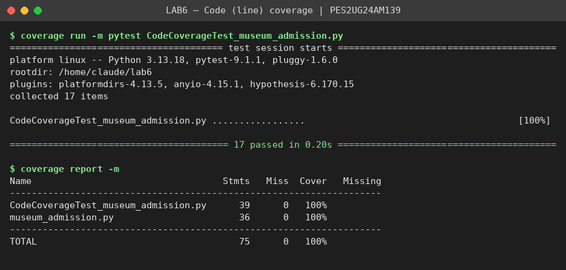
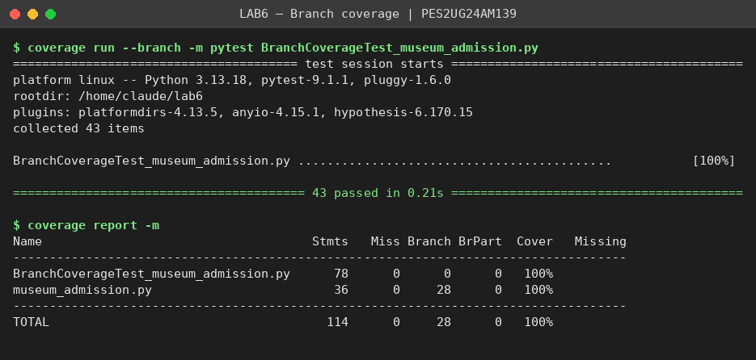

# Lab 6 – Code and Branch Coverage Analysis

**Name:** S Kushal Raju  
**SRN:** PES2UG24AM139  
**Assignment:** L6_L7_54 – Museum Admission

## Files

| File | Description |
|---|---|
| `museum_admission.py` | Module under test (given): `ticket_price`, `group_discount`, `gallery_entry` |
| `test_museum_admission.py` | Starter test file (given, 2 tests) |
| `CodeCoverageTest_museum_admission.py` | Test cases written for code (line) coverage |
| `BranchCoverageTest_museum_admission.py` | Test cases written for branch coverage |
| `screenshots/` | Terminal output of the coverage runs |

## How to run

```bash
pip install coverage pytest

# Code (line) coverage
coverage run -m pytest CodeCoverageTest_museum_admission.py
coverage report -m

# Branch coverage
coverage run --branch -m pytest BranchCoverageTest_museum_admission.py
coverage report -m
```

## Starting point (given tests only)

| Metric | `museum_admission.py` |
|---|---|
| Line coverage | 47% (19 of 36 statements missed) |
| Branch coverage | 42% (10 partial branches) |

## Code coverage – 100%

The 17 tests in `CodeCoverageTest_museum_admission.py` execute every statement once: both `raise` lines in each function, the free entry for under-5s, the Monday and weekend price changes, both guided-tour fees, every discount tier and all three gallery results.



## Branch coverage – 100%

The 43 tests in `BranchCoverageTest_museum_admission.py` (including parametrized cases) make each of the 14 decisions evaluate both **True and False** (28 branches). They also test the boundary value on each side of every comparison:

| Function | Decisions covered both ways | Boundary values tested |
|---|---|---|
| `ticket_price` | invalid category, `age < 0`, `age < 5`, Monday, weekend, guided tour, student-on-tour | age −1 / 0 / 4 / 5, every day type, case-sensitive "Monday"/"Adult" |
| `group_discount` | `size < 1`, school group, school `>= 20`, public `>= 15`, public `>= 8` | 0 / 1, 19 / 20, 14 / 15, 7 / 8 |
| `gallery_entry` | full (`>= capacity`), 90%-full **and** no timed slot | 89 / 90 / 100 / 120 of 100, 90% full with and without a slot, capacity 10 |

**Why branch coverage matters here:** `gallery_entry(90, 100, True)` and `gallery_entry(89, 100, False)` both reach the same `return "enter"` line. Line coverage counts that line as covered after either one, but only branch coverage checks that the queue condition was actually tested as False for both reasons (has a timed slot / below 90%).


